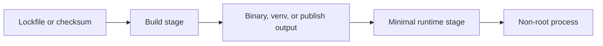

# Production container images

Templates you can copy. Each directory is one Dockerfile plus the few files it needs. Start from the closest one, change the version and your own files, then build that directory with `docker build`.

The comments in each Dockerfile explain what the command does. This page is the list of practices to keep while you edit: **make it work**, **make it secure**, and **make it fast**.



The picture is the shape of most templates. A first stage installs or compiles. A second stage keeps only what the process needs to run, and that process is not root.

The first line of every Dockerfile is:

```dockerfile
# syntax=docker/dockerfile:1
```

That line turns on BuildKit, the builder these files use. It is what makes three features work: a script written in the Dockerfile between `<<'EOF'` and `EOF`, a download cache that is not saved in the image (`--mount=type=cache`), and `COPY --link`.

## How to use a template

There is no Makefile and no script that builds every image. You work on one directory.

1. Copy the directory that matches what you are shipping (`runtimes/python`, `proxies/nginx`, `workloads/git`, ...).
2. Replace the sample source with your files. Keep the lockfile or checksum next to the Dockerfile.
3. Change the version on `FROM`, and on `ARG` when the file downloads a tool.
4. Point each `COPY` at your filenames and directories.
5. From that directory:

```bash
docker build --progress=plain -t my-app .
docker run --rm -p 8080:8080 my-app
```

`docker build` reads the Dockerfile and the files beside it, and produces an image named `my-app`. `--progress=plain` prints every step as text: `CACHED` when the step is reused, `DONE` when it runs. `docker run` starts a container from that image. `--rm` deletes the container when it exits. `-p 8080:8080` forwards your computer's port 8080 to the port the process listens on inside the container.

The Check column in the catalog is the URL or command that shows the sample is up.

## What each Dockerfile command means

Read this once. The same words are repeated, shorter, next to the command in each file.

**`FROM`** starts from an existing image. The text after `:` is the version (`python:3.14.8-slim-bookworm`). `AS build` names that stage so a later line can copy files out of it. A second `FROM` starts a fresh image: compilers and package managers from the first stage are left behind unless you copy them across.

**`ENV`** sets environment variables. In the last stage they are still set when the container runs.

**`WORKDIR`** creates a directory and makes it the current directory. Later `COPY` and `RUN` paths are relative to it.

**`COPY`** copies files into the image. By default the source is your project folder (the build context: the directory you pass to `docker build`).

- `--from=build` copies from the named stage instead of from your folder.
- `--chown=10001:10001` sets the owner as the files are copied. The two numbers are the user id and the group id.
- `--link` stores the copied files in their own layer. A layer is one saved step. If you change an earlier line (a new base image, a new user), Docker can keep this layer and skip copying those files again.

**`RUN`** executes a command during the build and saves the result in the image.

- `--mount=type=cache,target=/some/dir` attaches a folder that stays on the builder machine. Package managers keep downloads there. That folder is not stored in the image you ship. `sharing=locked` means only one build uses the folder at a time, so two builds cannot corrupt it.
- `<<'EOF'` … `EOF` is a shell script written in the Dockerfile. The quotes around `EOF` tell Docker to hand the script to the shell unchanged. `set -eu` stops the script on the first failing command, and on the first use of an empty variable.

**`ARG`** is a variable that exists only while building. `TARGETARCH` is filled in by Docker (`amd64` or `arm64`) so one file can download the matching binary. An `ARG` does not carry over a `FROM`. Write it again in the stage that uses it.

**`LABEL`** stores a title or description on the image. It does not change how the process runs.

**`USER`** switches away from root. Every command after it, including the program that starts, runs as that user. A number (`USER 10001`) is the user id. It still works if the image has no `/etc/passwd`.

**`EXPOSE`** records the port the process listens on. It does not open that port on your computer. `docker run -p` does.

**`STOPSIGNAL`** is the signal Docker sends when the container should stop. `SIGTERM` means "finish and exit". Nginx uses `SIGQUIT`. Apache uses `SIGWINCH`. Those programs treat that signal as a graceful stop.

**`HEALTHCHECK`** is a command Docker runs inside the container on a timer. Exit code 0 means healthy. Any other code is a failed check.

- `--interval` is the time between checks.
- `--timeout` aborts one check after this long.
- `--start-period` ignores failures while the process is still starting.
- `--retries` is how many failures in a row mark the container unhealthy.

The command calls `127.0.0.1`, which is the container itself. Images with no shell and no HTTP client (distroless) omit `HEALTHCHECK`. Call the URL from outside the container instead.

**`ENTRYPOINT`** is the program. **`CMD`** is its default arguments. The JSON form (`["nginx", "-g", "daemon off;"]`) starts the program directly, with no shell in front of it. Docker sends the stop signal to process 1. When the program is process 1, it receives that signal and can exit cleanly. You can replace `CMD` at run time (`docker run my-app --version`) without changing `ENTRYPOINT`.

## Catalog

Each row is one template. Build that directory. A `.dockerignore` in the directory lists files Docker must not send to the build (`.env`, keys, `.git`). The root `.dockerignore` does not apply, because the context is the template directory, not the repository root.

| Image | Path | Base | User | Check |
| --- | --- | --- | --- | --- |
| Python | `runtimes/python` | `python:3.14.8-slim-bookworm` | `10001` | `:8080/health` |
| Node.js | `runtimes/node` | `node:24.21.0-bookworm-slim` | `node` (`1000`) | `:8080/health` |
| Go | `runtimes/go` | `gcr.io/distroless/static-debian13:nonroot` | `65532` | `:8080/health` |
| Java | `runtimes/java` | `eclipse-temurin:25-jre-alpine-3.24` | `10001` | `:8080/health` |
| Rust | `runtimes/rust` | `gcr.io/distroless/cc-debian13:nonroot` | `65532` | `:8080/health` |
| Ruby | `runtimes/ruby` | `ruby:3.4.11-slim-bookworm` | `10001` | `:8080/health` |
| PHP-FPM | `runtimes/php` | `php:8.5.11-fpm-alpine3.24` | `www-data` (`82`) | `php-fpm -t` |
| .NET | `runtimes/dotnet` | `mcr.microsoft.com/dotnet/aspnet:10.0.12-alpine3.23` | `app` (`1654`) | `:8080/health` |
| Nginx | `proxies/nginx` | `nginx:1.30.5-alpine3.24` | `nginx` (`101`) | `:8080/health` |
| Apache | `proxies/apache` | `httpd:2.4.69-alpine3.24` | `www-data` (`82`) | `:8080/health` |
| Caddy | `proxies/caddy` | `caddy:2.11.6-alpine` | `65532` | `:8080/health` |
| HAProxy | `proxies/haproxy` | `haproxy:3.4.6-alpine3.24` | `haproxy` (`99`) | `:8080/health` |
| Traefik | `proxies/traefik` | `traefik:v3.7.13` | `65532` | `:8080/ping` |
| Envoy | `proxies/envoy` | `envoyproxy/envoy:distroless-v1.39.2` | `65532` | `:8080/` |
| Git | `workloads/git` | `alpine:3.24` | `10001` | `git --version` |
| kubectl | `workloads/kubectl` | distroless static | `65532` | `kubectl version --client` |
| Helm | `workloads/helm` | distroless static | `65532` | `helm version` |
| Terraform | `workloads/terraform` | distroless static | `65532` | `terraform version` |
| Prometheus | `workloads/prometheus` | distroless static | `65532` | `:9090/-/healthy` |
| Trivy | `workloads/trivy` | distroless static | `65532` | `trivy --version` |
| Ansible | `workloads/ansible` | `python:3.14.8-slim-bookworm` | `10001` | `ansible --version` |
| AWS CLI | `workloads/aws-cli` | `amazon/aws-cli:2.37.9` | `10001` | `aws --version` |

```bash
docker build --progress=plain -t ref-python runtimes/python
docker run --rm -p 8080:8080 ref-python
```

Versions below are the ones written into these templates. When you change a version, change the lockfile or the checksum in the same edit. A failed checksum or hash means the downloaded file is not the one you pinned.

## Make it work

An image works when a new teammate can build it, run it, and stop it without reading the base image's defaults.

### Pin the toolchain the process actually runs

Tags in `FROM` are full patch releases (`python:3.14.8-slim-bookworm`, `nginx:1.30.5-alpine3.24`) or, for Alpine itself, a major.minor (`alpine:3.24`) whose packages are then pinned. `:latest` is not used.

Application dependencies are locked the way that ecosystem already locks them:

| Ecosystem | Pin |
| --- | --- |
| Python | `requirements.txt` with `--hash`, installed with `--require-hashes` |
| Node.js | `package-lock.json` and `npm ci` |
| Go | `go.mod` (add `go.sum` beside it when modules appear) |
| Ruby | `Gemfile.lock` and `bundle install` under `BUNDLE_DEPLOYMENT=1` |
| PHP | `composer.lock` and `composer install --no-dev` |
| .NET | `packages.lock.json` and `dotnet restore --locked-mode` |
| Rust | `Cargo.lock` and `cargo build --locked` |
| Downloaded binaries | version in the URL plus a sha256 checked with `sha256sum -c` |

Checksums for kubectl, Helm, Terraform, Prometheus, and Trivy are written next to the `curl` in those Dockerfiles. Lockfiles (`requirements.txt`, `package-lock.json`, `Gemfile.lock`, `composer.lock`, `Cargo.lock`, `packages.lock.json`) sit next to the Dockerfile. Refresh a lockfile with that language's own tool when you change a dependency, then commit the new file.

### One process, in the foreground, in exec form

`ENTRYPOINT` and `CMD` use the JSON form (`["program", "arg"]`). That starts the program directly, so it is process 1 and receives the stop signal. A shell in front (`sh -c "nginx"`) would receive the signal instead, and the server would not get a chance to finish.

`STOPSIGNAL` matches the program: `SIGTERM` for most servers, `SIGQUIT` for Nginx, `SIGWINCH` for Apache's graceful stop.

The sample programs also handle `SIGTERM` themselves (Go, Node, Java, Rust). Gunicorn, Puma, the .NET host, and the proxies already do.

### Say where the process lives and how it is configured

`WORKDIR` is set in every stage that copies or runs something, so paths do not depend on the base image's default directory.

`ENV` carries the defaults operators look for: `PYTHONUNBUFFERED`, `NODE_ENV=production`, `ASPNETCORE_HTTP_PORTS`, `TF_IN_AUTOMATION`, `AWS_PAGER`. Secrets are not stored in `ENV`. See the secure section for build-time secrets.

### Logs, health, and a real stop

Servers log to stdout or stderr. Nginx and Apache send access logs to `/dev/stdout` and errors to `/dev/stderr` or `/proc/self/fd/2`. PHP-FPM does the same. Nothing writes an access log onto the container filesystem.

`HEALTHCHECK` uses a binary already in the image (`wget` on Alpine, `python`/`node`/`ruby` for those runtimes, `traefik healthcheck`, `php-fpm -t`). Distroless images have no shell and no HTTP client, so they document the URL for the orchestrator probe instead of faking a check.

### Multi-stage keeps the runtime able to start

Multi-stage is used when the build needs tools the process must not ship:

| Image | Build stage | What the runtime keeps |
| --- | --- | --- |
| Go | `golang:1.27.1-alpine3.24` | static binary and CA certificates |
| Rust | `rust:1.99.0-slim-bookworm` | glibc-linked binary on `distroless/cc` |
| Java | Temurin JDK | Temurin JRE and class files |
| .NET | SDK `10.0.200` | ASP.NET runtime `10.0.12` and the published app |
| Python, Ansible | venv with pip | venv without pip |
| Ruby | compilers and Bundler | gems and Puma |
| PHP | Composer | `vendor/` and PHP-FPM |
| CLIs | Alpine with `curl` | the verified binary |

PHP-FPM is the PHP runtime. Put the Nginx image in front of port 9000. The PHP image listens on 9000 and does not serve HTTP itself.

### A context that matches the Dockerfile

Each directory has a `.dockerignore`. The daemon never receives `.env`, keys, `.git`, or a local `target/` / `node_modules/`. `COPY` names the files the stage needs (`package.json` and `package-lock.json`, then `server.js`) instead of `COPY . .` before dependencies are installed.

## Make it secure

A smaller image that still runs as root, or a pinned image that embeds a secret, is not done.

### Pin bases, packages, and bytes

- Base images use a patch tag from Docker Official Images, Microsoft, Amazon, HashiCorp's release host, or `gcr.io/distroless`.
- `apt-get install` and `apk add` name exact versions (`openssh-client=1:9.2p1-2+deb12u10`, `git=2.54.0-r0`).
- `--no-install-recommends` and Alpine `--no-progress` keep suggested packages out.
- Downloaded CLIs are checked against a checksum written in the Dockerfile before `chmod`.
- Pip installs refuse anything that is not in the hashed requirements file, and they refuse source builds (`--only-binary=:all:`).

For a stronger base pin, append the image digest after you have inspected it:

```bash
docker buildx imagetools inspect python:3.14.8-slim-bookworm
```

```dockerfile
FROM python:3.14.8-slim-bookworm@sha256:<digest>
```

A digest does not move when the tag is rebuilt. You then bump it on purpose. Rebuild on a schedule either way: `docker build --pull` picks up a rebuilt tag, and a digest pin moves only when you change the Dockerfile.

Apt and apk pins fail closed when the distro removes that exact package version. Refresh the pin from the base image (`apt-cache policy`, `apk policy`) and commit the new version. That failure is the signal to look at the update.

### Small bases, chosen for the binary you ship

| Binary | Runtime base | Why |
| --- | --- | --- |
| Static Go, kubectl, Helm, Terraform, Prometheus, Trivy | `gcr.io/distroless/static-debian13:nonroot` | no shell, no package manager, CA certificates present |
| Rust linked to glibc | `gcr.io/distroless/cc-debian13:nonroot` | `libgcc` and libc, still no shell |
| Envoy | `envoyproxy/envoy:distroless-v1.39.2` | upstream already ships this form |
| CPython, Ruby | Debian slim | wheels and native extensions expect glibc |
| Node.js | `bookworm-slim` of the same patch | native addons must match this Node build |
| Java | Temurin JRE Alpine | no `javac` |
| .NET | ASP.NET Alpine runtime | no SDK |
| Nginx, Apache, PHP, Caddy, HAProxy, Git | Alpine variants of the official image | the upstream build, minus a root entrypoint where that entrypoint only existed to start as root |

Distroless is not the right last stage for CPython or for a Node addon compiled against a different Node. The Dockerfiles say so in the stage comment.

### Run as a user that already exists, or create one

| Situation | What the Dockerfile does |
| --- | --- |
| The base image has a user | `USER node`, `USER nginx`, `USER haproxy`, `USER www-data`, `USER app` |
| The base image is root-only | `groupadd` / `addgroup` and a dedicated user, uid `10001` or `65532` |
| Distroless `nonroot` | `USER 65532`, which matches the account in that image |

Numeric ids are the values to put in `runAsUser`. Kubernetes `runAsNonRoot: true` then has an account to map to.

Official entrypoints that `chown` the filesystem or bind port 80 are replaced. Nginx, Apache, Caddy, and Traefik listen on **8080**. HAProxy's upstream image is already user `haproxy`; the config does not setuid again. PHP-FPM's pool does not call `setuid` because the master is already `www-data`.

`pip`, Composer, and the .NET SDK are not in the runtime stage. The Python and Ansible venvs uninstall pip after install.

### Production dependencies only

- `npm ci --omit=dev`
- `composer install --no-dev --no-scripts`, then a classmap autoload
- `BUNDLE_WITHOUT=development:test`
- `dotnet publish -c Release` into the ASP.NET runtime, not the SDK
- Ansible installs `ansible-core`, not a full Ansible collection set and not a compiler

`--no-scripts` on Composer skips code from the package during the build. Turn scripts back on only for a package that must run one, and pin that package.

### Secrets stay out of layers

Anything in `ENV`, `ARG`, or a `COPY`d file is in the image history. Passwords and tokens go through a BuildKit secret mount, which exists only for that `RUN` and is not committed:

```dockerfile
RUN --mount=type=secret,id=pip,target=/root/.config/pip/pip.conf \
    pip install --require-hashes -r requirements.txt
```

```bash
docker build --progress=plain --secret id=pip,src=./pip.conf -t ref-python runtimes/python
```

The images in this repo build with no secret, because the sample apps have none. `.dockerignore` still excludes `.env` and private keys so a later `COPY` cannot pick them up by accident.

### Defaults that reduce exposure

- Nginx `server_tokens off`, Apache `ServerTokens Prod` and `TraceEnable Off`, PHP `expose_php=0`
- Response headers: `X-Content-Type-Options`, `X-Frame-Options`, `Referrer-Policy` on the HTTP servers that can set them
- Go HTTP server sets `ReadHeaderTimeout` so a slow header stream cannot hold a worker
- Terraform `CHECKPOINT_DISABLE=1` and Trivy `TRIVY_SKIP_VERSION_CHECK=1` so a version command does not phone home
- Traefik `sendAnonymousUsage: false` and the dashboard bound off
- Envoy's admin port listens on `127.0.0.1` only
- AWS CLI `AWS_PAGER` and `AWS_CLI_AUTO_PROMPT` are off so the process cannot wait on a pager

### Runtime policy the Dockerfile cannot express

Drop privileges again at the orchestrator. The ids match the catalog.

```yaml
securityContext:
  runAsNonRoot: true
  runAsUser: 10001
  readOnlyRootFilesystem: true
  allowPrivilegeEscalation: false
  capabilities:
    drop: ["ALL"]
volumeMounts:
  - name: tmp
    mountPath: /tmp
volumes:
  - name: tmp
    emptyDir: {}
```

Writable paths that a read-only root still needs:

| Image | Writable path |
| --- | --- |
| Prometheus | `/home/nonroot/data` |
| Caddy with TLS | `/data`, `/config` |
| Trivy scans | `/home/nonroot/.cache/trivy` |
| Terraform | `/tmp/terraform-plugins`, `/home/nonroot` |
| AWS CLI | `/home/app` (for `~/.aws`) |
| Nginx, Apache, PHP-FPM, HAProxy | `/tmp` |

Scan the built image with the Trivy image in this repo once you mount a Docker socket on purpose, or point Trivy at an exported tarball. The Trivy Dockerfile does not mount the socket for you.

## Make it fast

Fast means the next build after a one-line source change reuses dependency work, and the registry push is only the layers that changed.

### Order instructions by how often they change

The stable steps come first: base image, user creation, dependency manifest, dependency install. Application source is last.

```dockerfile
COPY --link requirements.txt ./
RUN --mount=type=cache,target=/root/.cache/pip \
    pip install --require-hashes --only-binary=:all: -r requirements.txt
COPY --link app.py ./
```

The same split is `package.json` then `npm ci` then `server.js`, `go.mod` then `go mod download` then the rest, `Cargo.toml` and `Cargo.lock` then `cargo fetch` then `src/`, `App.csproj` and `packages.lock.json` then `dotnet restore` then `Program.cs`.

### Cache mounts

A cache mount keeps a package manager's download cache on the builder. The cache is not an image layer. The install must still succeed on an empty cache, because BuildKit may garbage-collect it.

| Tool | Mount | Sharing |
| --- | --- | --- |
| apt | `/var/cache/apt` and `/var/lib/apt/lists` | `locked` (apt corrupts a shared list directory) |
| apk | `/var/cache/apk` | `locked` |
| pip | `/root/.cache/pip` | shared is fine |
| npm | `/root/.npm` | `locked` |
| Go | `/go/pkg/mod` and `/root/.cache/go-build` | `locked` |
| Cargo | registry, git, and the target dir | `locked` |
| Bundler | `/usr/local/bundle/cache` only | `locked` |
| NuGet | `/root/.nuget/packages` | `locked` |
| Composer | `/tmp/composer-cache` | `locked` |

`PIP_NO_CACHE_DIR` is not set. That variable disables the cache the mount is there to keep. The mount already prevents the cache from landing in the image.

Do not mount the directory you need to keep. A mount on `/usr/local/bundle` would hide the installed gems when the `RUN` ends. Cargo's target directory is mounted, and the binary is `cp`'d to `/out` in that same `RUN`, while the mount is visible.

Apt lists are not deleted when `/var/lib/apt/lists` is a cache mount. Deleting them would wipe the cache. They are not in the layer either, because the mount is not committed. Alpine is installed without `apk --no-cache` for the same reason: `--no-cache` turns the cache off.

### `COPY --link`

`COPY --link` stores the copied files in their own layer. If an earlier line changes (a new base image, a new user), Docker can keep this layer and skip copying those files again. Use it for directories this file owns (`/opt/venv`, `/app`, config files). It does not merge files into a path that is a symlink.

`--chown` on that `COPY` sets the owner while the layer is created. A later `RUN chown -R` would save a second copy of every file. The id is numeric (`1000:1000` for the `node` user). With `--link`, Docker does not read the base image's user list, so the name `node` cannot be looked up.

### One `RUN` for one unit of work

Steps that always run together share a heredoc, so a failure cannot leave a half-applied layer and the Dockerfile stays readable:

```dockerfile
RUN --mount=type=cache,target=/var/cache/apk,sharing=locked \
    <<'EOF'
set -eu
apk add --no-progress git=2.54.0-r0 ca-certificates=20260909-r0
addgroup -g 10001 app
adduser -D -u 10001 -G app -h /home/app -s /sbin/nologin app
EOF
```

The quoted `'EOF'` stops the Dockerfile parser from eating `$`. The shell still expands `TARGETARCH` and the version `ARG`, which BuildKit exports to that `RUN`. Checksums are written to a file and passed to `sha256sum -c`. Debian slim's `/bin/sh` is dash, which has no `pipefail`, so a `echo hash | sha256sum` pipe is not used: a failing check has to be the command's own exit status.

### Smaller artifacts

- Go: `CGO_ENABLED=0`, `-trimpath`, `-ldflags='-s -w'`
- Rust: `--release` and `strip`
- .NET: framework-dependent publish, `UseAppHost=false`, invariant globalization so Alpine does not need ICU
- Java: `-XX:MaxRAMPercentage=75` and exit on `OutOfMemoryError`, so the heap follows the cgroup
- Multi-arch CLIs: `ARG TARGETARCH` selects the tarball and the matching checksum. Buildx sets it. An unknown architecture fails the build.

### See the cache work

```bash
docker build --progress=plain -t ref-go runtimes/go
# edit runtimes/go/main.go
docker build --progress=plain -t ref-go runtimes/go
```

The `go mod download` layer and the module cache mount are reused. The compile `RUN` reruns. `COPY --link` keeps the runtime copy of an unchanged binary reusable across a base-image bump.

BuildKit can also attach a provenance attestation and an SBOM when you push:

```bash
docker buildx build --progress=plain --sbom=true --provenance=true -t registry.example/ref-go --push runtimes/go
```

## Image notes

**Python.** Both stages use the same `3.14.8-slim-bookworm` tag because the venv's `python` symlink points at `/usr/local/bin/python`. Gunicorn is the production process. The sample has no third-party library besides Gunicorn, and that wheel is hash-pinned.

**Node.js.** Node 24 is the long-term support line. Put production packages in `dependencies`. `npm ci --omit=dev` skips `devDependencies` when you add them. The official `docker-entrypoint.sh` is not used, so `node` is process 1 and receives the stop signal.

**Go.** `go 1.27` matches the `1.27.1` toolchain. There is no `go.sum` until the module has a dependency; copy it next to `go.mod` when you add one. The final image has no shell. Probe `/health` from outside.

**Java.** `javac` runs on the JDK Alpine image. The JRE image does not contain it. The CA-import entrypoint from Temurin expects to start as root, so the runtime calls `java` directly. The trust store shipped in the image is already populated.

**Rust.** The bookworm builder links glibc, so the runtime is `distroless/cc`, not `distroless/static`. `libc` is a real dependency, which is why `Cargo.lock` and `cargo fetch` are in the build. A fully static musl binary would be a different target and a `distroless/static` runtime.

**Ruby.** `gcc` and `g++` exist only in the build stage, for Puma's native extension. Bundler 4 installs gems under `/usr/local/bundle/ruby/3.4.0`, and `GEM_HOME` points there so the `puma` binstub can find them.

**PHP.** Composer 2.9.8 installs Monolog from the lockfile and is discarded. OPcache does not revalidate timestamps (`opcache.validate_timestamps=0`); rebuild the image to ship PHP changes. Workers are a fixed `pm = static` count.

**.NET.** SDK band `10.0.200` publishes a `net10.0` app. The runtime tag is the patch release `10.0.12` on Alpine 3.23. User `app` is the one Microsoft already creates. `ASPNETCORE_HTTP_PORTS=8080` is how this runtime picks the listen port.

**Nginx.** Stable 1.30, not mainline. The master runs as `nginx` and listens on 8080. `/health` is generated inside Nginx. `/` proxies to `app:8080` through a variable, so startup does not require that name to resolve. Temp paths and the pid file are under `/tmp/nginx`.

**Apache.** The stock config listens on port 80 and setuids from root. It is replaced. `/health` is an alias of the static document. `DefaultRuntimeDir /tmp` keeps the scoreboard writable.

**Caddy.** The upstream Alpine image has no `caddy` user. Uid `65532` is created and owns `/data` and `/config`. Automatic HTTPS is off so the process does not need ports 80 and 443. The `reverse_proxy` line is in the Caddyfile as a comment so startup does not require a backend DNS name.

**HAProxy.** User `haproxy` is already the image user. The config binds `:8080`, returns 200 for `/health`, and has a backend named `app` with `init-addr none`, so a missing DNS name does not stop startup. There is no `user` line, because setuid would fail without `CAP_SETUID`.

**Traefik.** Config file pins the static options: ping on the `web` entrypoint, version checks and anonymous usage off, and aliased request headers dropped. `traefik healthcheck --ping` is the Docker health check. Add a file provider when you have real routers.

**Envoy.** Distroless, config at the path the upstream image already uses. Every request gets a direct `200` so the image is testable without a cluster. Admin is localhost-only.

**Git.** `git` and `ca-certificates` only. The entrypoint is `git`, so `docker run --rm ref-git clone https://...` works. The default command prints the version.

**kubectl, Helm, Terraform, Trivy.** Fetch on Alpine, verify sha256, copy a single binary onto distroless. `TARGETARCH` is `amd64` or `arm64`. Trivy's archive names (`Linux-64bit`, `Linux-ARM64`) are mapped in the `case` statement.

**Prometheus.** Same fetch pattern. The TSDB directory is `/home/nonroot/data`, which uid `65532` can create. Retention is 24 hours so a demo container does not fill a disk. Scrape target is Prometheus itself.

**Ansible.** `requirements.in` names `ansible-core`. `requirements.txt` is the hashed tree from `pip-compile`. OpenSSH client is installed in the runtime stage because Ansible uses it at run time. There is no `ENTRYPOINT`, so `ansible-playbook` and `ansible-galaxy` are both reachable. Host key checking stays at Ansible's default. Set `ANSIBLE_HOST_KEY_CHECKING` at run time for a disposable lab, and mount a `known_hosts` file for a long-lived controller.

**AWS CLI.** The official 2.37.9 image is Amazon Linux and does not include `useradd`. The Dockerfile appends uid `10001` to `/etc/passwd` instead of installing shadow-utils for a single account. Credentials belong in a mounted `~/.aws` or in the task role, not in the image.

## Changing a version

Edit the template, then build that one directory.

1. Change the version on `FROM`, or on `ARG` for a downloaded tool.
2. For a library, edit the manifest and refresh its lockfile with that language's tool: `pip-compile` for Ansible's `requirements.in`, `npm install` for Node, `bundle lock` for Ruby, `composer update --no-install` for PHP, `cargo generate-lockfile` for Rust, `dotnet restore --use-lock-file` for .NET. Python's `requirements.txt` already holds the hashes; edit those hashes when the package changes.
3. For a downloaded binary, replace the checksums with the values from that release's `SHA256SUMS` file.
4. For an `apt` or `apk` version that no longer exists, read the current one inside the base image (`apt-cache policy <package>` or `apk policy <package>`) and write it into the Dockerfile.
5. Build and run the directory you changed:

```bash
docker build --progress=plain -t my-app runtimes/python
docker run --rm -p 8080:8080 my-app
```
